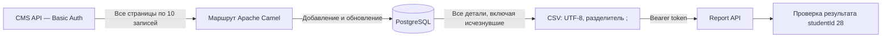

# Интеграция складских систем

Семестровый проект по дисциплине «Интеграция систем, разработка интеграционных сервисов».

**Студент:** Мясников Иван Сергеевич. **studentId:** 28.

Приложение на **Apache Camel 4.18.5 LTS, Java 21 и PostgreSQL 16** получает складские детали из CMS, сохраняет историю, формирует CSV и отправляет его в Report API. Пароли задаются локально и не входят в репозиторий.



## Быстрый запуск

Нужен запущенный Docker Desktop с Linux-контейнерами. Для запуска собранного JAR дополнительно нужна Java 21 или новее.

1. Скопировать `.env.example` в `.env`.
2. В `.env` указать пароль студента из D29 ведомости и собственный случайный пароль PostgreSQL. Значения с `$` в Docker Compose следует заключать в одинарные кавычки. Приложение также понимает внешние одинарные и двойные кавычки.
3. Запустить из каталога проекта:

```powershell
docker compose up -d --wait db
docker compose --profile app run --build --rm app sync
```

Первый запуск собирает приложение. Повторная синхронизация уже собранного образа:

```powershell
docker compose --profile app run --rm app sync
```

Для подготовленной локальной копии с JAR доступен короткий запуск:

```powershell
.\run.ps1
```

Команды приложения:

| Команда | Назначение |
|---|---|
| `sync` | Получить все страницы, сохранить историю, создать CSV, отправить его и проверить оценку |
| `results` | Прочитать текущую оценку без отправки CSV |
| `export` | Выгрузить данные из собственной БД в CSV без обращения к Report API |

Например: `.\run.ps1 results` или `docker compose --profile app run --rm app results`.

## Настройки

| Переменная | Значение / назначение |
|---|---|
| `COURSE_API_BASE_URL` | `http://77.67.89.207:8080` |
| `COURSE_STUDENT_ID` | `28` |
| `COURSE_API_USERNAME` | `student28` |
| `COURSE_API_PASSWORD` | Пароль из ведомости |
| `COURSE_DB_URL` | Для Java на компьютере: `jdbc:postgresql://localhost:15428/integration`; в контейнере задаётся автоматически |
| `COURSE_DB_USER` | `integration` |
| `COURSE_DB_PASSWORD` | Локальный пароль БД |
| `COURSE_REPORT_DIR` | `reports` |
| `COURSE_MAX_PAGES` | Предельное число страниц: по умолчанию `10000`; защита от бесконечной пагинации |

Значения окружения имеют приоритет над `.env`. Префикс `COURSE_` отделяет настройки проекта от настроек других приложений. База доступна только через локальный адрес `127.0.0.1:15428`.

## Логика и маршруты

`IntegrationRoutes.java` содержит три маршрута Camel:

- `cms-to-postgres-to-report`: постраничная загрузка → валидация → транзакция БД → CSV → авторизация → отправка → самопроверка.
- `report-authentication`: получение токена через `POST /auth/token`.
- `student-results`: чтение `GET /students/28/results`.

CMS вызывается через `GET /cms/spares?page=N&size=10`, начиная с нуля. После полной страницы читается следующая, в том числе пустая завершающая страница. Все HTTP-вызовы выполняет компонент `camel-http`. Используется оркестрация маршрутом, цикл пагинации и преобразование сообщений процессорами Camel. JDBC-слой отвечает за транзакции хранения.

Новая деталь добавляется по ключу `(student_id, spare_code)`. Существующая обновляется. Исчезнувшая из CMS деталь остаётся в истории с `is_present=false` и включается в отчёт. Сохраняются также полные снимки каждого успешного получения данных. История означает сохранение исчезнувших деталей; снимки дополнительно позволяют посмотреть прежние значения изменённых деталей.

Таблицы:

- `spares`: последнее известное состояние каждой детали, признаки присутствия, даты первого и последнего получения.
- `spare_snapshots`: исходные данные деталей для каждого запуска.
- `sync_runs`: журнал запусков, количество деталей, статус и ответ проверки.

Все страницы проверяются до записи. Ошибка на одной из страниц или повтор кода останавливает синхронизацию без частичного изменения истории и без отправки отчёта. Обновление деталей и запись снимка выполняются одной транзакцией. Блокировка PostgreSQL запрещает параллельные синхронизации одного студента.

Если отправка CSV завершилась ошибкой, история и файл остаются локально. Команду можно выполнить повторно: записи деталей не дублируются. Автоматических повторов POST нет. Пустая выдача CMS считается ошибкой и требует проверки, поэтому пустой отчёт не отправляется. Если отчёт принят, но последующая проверка не удалась, в журнале остаётся `SUBMITTED_VERIFY_FAILED` и сохранённый ответ отправки.

CSV не содержит заголовка и BOM. Кодировка — UTF-8, разделитель — `;`, перенос строки — LF. Порядок полей:

```text
spareCode;spareName;spareDescription;spareType;spareStatus;price;quantity;updatedAt
```

Порядок строк стабилен по коду детали. Десятичная цена и время сохраняются без округления и потери точности. Специальные символы экранируются по правилам CSV.

## Результаты и резервная копия

После синхронизации в локальном каталоге `reports` появляются:

- `latest.csv` и отдельный CSV каждого запуска;
- `latest-result.json`: текущий ответ сервера;
- `latest-summary.json`: количество полученных и сохранённых деталей, ответ отправки и самопроверки;
- отдельный JSON с ответом отправки каждого запуска.

Каталоги `reports`, `backups`, `.env` и файлы сборки исключены из Git. Пароль и токен не выводятся приложением в журнал.

Создание резервной копии базы:

```powershell
.\backup.ps1
```

Файл PostgreSQL Custom Archive сохраняется в `backups`. Его можно восстановить командой `pg_restore` в отдельную пустую БД. В рабочей копии данные PostgreSQL живут в Docker volume `myasnikov-integration_history`: они сохраняются после остановки и перезапуска контейнера. **Не выполнять `docker compose down -v`: это удаляет историю.**

## Сборка и тестирование

Для локальной сборки нужны Java 21 и Maven 3.9+:

```powershell
mvn -B package
java -jar target/warehouse-integration-1.0.0.jar sync
```

Для всех тестов требуется тестовая PostgreSQL. Интеграционные тесты создают отдельную временную схему для каждого сценария и удаляют только её. Рабочие таблицы не изменяются.

```powershell
$env:TEST_DB_URL = 'jdbc:postgresql://localhost:15428/integration'
$env:TEST_DB_PASSWORD = 'your-local-database-password'
mvn -B verify
```

Без `TEST_DB_URL` интеграционные тесты пропускаются; модульные тесты CSV выполняются. CI в GitHub запускает все тесты с отдельным сервисом PostgreSQL.

Проверяются два периода, сохранение исчезнувших деталей, обновление и повторный запуск, все страницы и пустая последняя страница, ошибка промежуточной страницы, дубли кодов, отказ Report API, пустой источник, ответ для другого студента, блокировка параллельного запуска, порядок и экранирование CSV, точность цены и времени, валидация неполных записей.

## Сдача и второй период

Исходники должны находиться в открытом GitHub-репозитории, ссылка — в E29 ведомости. Итоговая оценка курса зависит также от проверки преподавателем реализации. Значение, возвращаемое API, является автоматической проверкой данных.

По условиям курса преподаватель меняет данные примерно в середине декабря; точную дату сообщает отдельно. Первый набор необходимо сохранить до смены данных, затем снова выполнить `sync` после смены периода **с той же базой**. Приложение запускается по команде, фонового расписания нет. Держать Java-приложение постоянно запущенным не нужно.

Источники: [Swagger и задание курса](http://77.67.89.207:8080/swagger-ui/index.html), [ведомость](https://docs.google.com/spreadsheets/d/10JvlxZqUYWOvKyBereIqsWaCyMxvBz-KHLqr5501WRw/edit), [Apache Camel HTTP](https://camel.apache.org/components/4.18.x/http-component.html).
